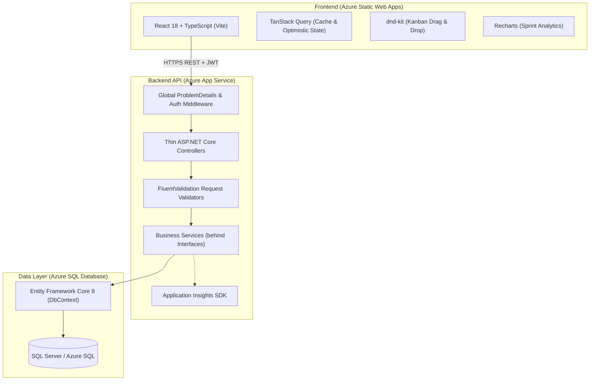
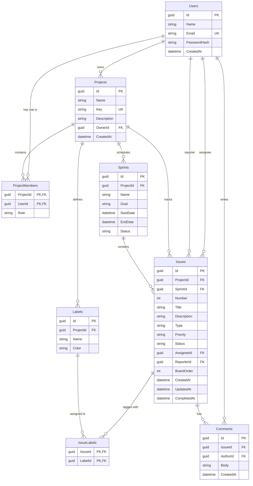

# Bugbox

> A lightweight, Jira-style issue tracker engineered for student and hackathon teams.

Bugbox is a full-stack, production-minded issue tracker built with **ASP.NET Core (.NET 8 LTS)**, **Entity Framework Core**, **SQL Server**, and **React 18 + TypeScript + Vite + Tailwind CSS**. It balances professional software engineering practices—layered architecture, transactional integrity, optimistic UI updates, strict DTO isolation, and automated CI/CD—without excessive enterprise over-engineering.

[](https://github.com/your-username/bugbox/actions/workflows/ci.yml)
[](https://github.com/your-username/bugbox/actions/workflows/deploy.yml)
[](LICENSE)

---

## Live Demo & Screenshots

- **Live Application**: [https://swa-bugbox-web.azurestaticapps.net](https://swa-bugbox-web.azurestaticapps.net) *(Deploy placeholder)*
- **API Swagger Documentation**: [https://app-bugbox-api-prod.azurewebsites.net/swagger](https://app-bugbox-api-prod.azurewebsites.net/swagger) *(Interactive OpenAPI UI)*
- **Quick Demo Experience**: Click **"Try Demo Project"** on the Projects screen or invoke `POST /api/demo/seed` to instantly load a fully populated project (`MOB`) with team members, active and completed sprints, Kanban board issues across all status columns, and burndown chart analytics.

### Screenshots

| Interactive Kanban Board | Sprint Burndown Chart |
|:---:|:---:|
|  |  |
| *Smooth drag-and-drop column transitions with optimistic updates and error rollback* | *Daily burndown chart with ideal linear descent vs actual issues remaining* |

| Issue Detail & Discussion | Sprint Backlog & Planning |
|:---:|:---:|
|  |  |
| *Full field editing, label chips, assignment, and real-time comment threads* | *Inline issue creation, sprint assignment, and backlog triage* |

---

## Tech Stack

### Backend
- **Framework**: ASP.NET Core Web API (.NET 8 LTS)
- **Data Access**: Entity Framework Core 8, EF Core Migrations
- **Database**: SQL Server (LocalDB / Docker locally, Azure SQL in production)
- **Authentication**: Stateless JWT Bearer tokens, BCrypt password hashing (work factor 11)
- **Validation**: FluentValidation with automatic model validation filters
- **Error Handling**: RFC 7807 `ProblemDetails` standard global exception middleware
- **Telemetry**: Application Insights SDK integration
- **Documentation**: Swagger / OpenAPI with JWT Authorization scheme (available in all environments)

### Frontend
- **Framework**: React 18, TypeScript, Vite
- **Routing**: React Router v6
- **Server State**: TanStack Query v5 (React Query) with cache invalidation and optimistic updates
- **Styling**: Tailwind CSS
- **Interactions**: `@dnd-kit` (Kanban drag-and-drop)
- **Data Visualization**: Recharts (Sprint burndown ideal vs actual lines)
- **Icons**: Lucide React

### Testing & DevOps
- **Backend Tests**: xUnit, FluentAssertions, EF Core In-Memory database, Coverlet code coverage
- **Frontend Tests**: Vitest, React Testing Library, jsdom
- **CI/CD**: GitHub Actions (automated build, lint, backend + frontend tests, code coverage, Azure deployment)
- **Hosting**: Azure App Service (API), Azure Static Web Apps (Frontend), Azure SQL Database

---

## System Architecture

Bugbox uses a clean, layered architecture ensuring strict separation of concerns, testability, and deterministic behavior:



---

## Entity Relationship Diagram (Data Model)



---

## Design Decisions

### 1. Why Layered Architecture over CQRS / MediatR?
For student and hackathon issue trackers, standard layered architecture (`Controllers -> Services -> DbContext/Entities`) provides immediate clarity, single-step debugging, and high testability. Introducing CQRS or MediatR adds ceremony (separate queries, commands, handlers, and pipeline behaviors) without architectural benefit for an app of this size. Interfaces like `IIssueService` and `IProjectService` isolate business logic cleanly and allow straightforward unit and integration testing.

### 2. Why Stateless JWT + BCrypt?
- **Stateless Horizontally Scalable Auth**: The API server requires no session state in memory or Redis cache. Authentication headers are verified cryptographically via standard symmetric signing keys.
- **BCrypt Password Derivation**: Passwords are never stored in plain text and are hashed using BCrypt with work factor 11, protecting against dictionary and rainbow table attacks.
- **Security Boundary**: All user claims are parsed directly from the JWT via `ICurrentUserService`, preventing identity spoofing.

### 3. Safe Sequential Issue Numbers (`KEY-12`)
In systems like Jira, users identify issues by human-readable keys such as `BUG-1`, `BUG-2`, rather than raw GUIDs. Generating sequential counters safely under concurrent requests requires strict transaction isolation:
- The issue creation query opens a `Serializable` transaction (or acquires an exclusive lock).
- It calculates `MAX(Number) + 1` scoped strictly to that `ProjectId`.
- The compound unique index on `(ProjectId, Number)` at the database level guarantees zero collisions even under heavy concurrent load.

### 4. Burndown Chart Calculation Engine
The burndown chart is computed on demand via `GET /api/sprints/{id}/burndown`:
1. **Time Horizon**: Discretized into daily calendar steps from `StartDate` to `EndDate`.
2. **Ideal Descent Line**: A linear slope calculated as:
   $$\text{Ideal}(d) = T - \left(T \times \frac{d}{N}\right)$$
   where $T$ is the total issues committed to the sprint and $N$ is total sprint duration in days.
3. **Actual Remaining Issues**: Evaluated on each day $d$ by counting all sprint issues minus issues where `Status == Done` and `CompletedAt <= d`.
4. **Re-Opening Handled Gracefully**: If an issue moves from `Done` back to `InProgress`, `CompletedAt` is cleared to `null`, instantly reflecting the re-opened work in the remaining curve.

### 5. Optimistic Kanban Drag & Drop with Rollback
When an issue card is dragged to a new column on the frontend board:
1. TanStack Query cancels outgoing queries for the active issue list.
2. An optimistic snapshot is saved into the mutation context and the UI updates the card column and board order immediately.
3. The API call `PATCH /api/issues/{id}/move` persists the new status and order.
4. If the network drops or the server returns an error, the mutation `onError` handler rolls back the board state to the pre-drag snapshot and triggers an error toast notification.

---

## Local Setup & Development

### Prerequisites
- [.NET 8.0 SDK](https://dotnet.microsoft.com/download/dotnet/8.0)
- [Node.js 18+](https://nodejs.org/) & `npm`
- SQL Server (LocalDB, Docker, or Azure SQL)
- `dotnet-ef` CLI tool:
  ```bash
  dotnet tool install --global dotnet-ef
  ```

### 1. Clone & Configure Backend
```bash
# Set connection string and JWT secret via user-secrets (recommended for local development)
cd backend/src/Bugbox.Api
dotnet user-secrets set "ConnectionStrings:DefaultConnection" "Server=(localdb)\\mssqllocaldb;Database=BugboxDb;Trusted_Connection=True;MultipleActiveResultSets=true;TrustServerCertificate=True"
dotnet user-secrets set "Jwt:SecretKey" "Bugbox_Super_Secret_Development_Key_32_Chars!"

# Apply EF Core migrations to create database
dotnet ef database update --project ../Bugbox.Infrastructure --startup-project .

# Run the API
dotnet run
```
- Swagger UI will be available at `http://localhost:5000/swagger`.
- Health check available at `http://localhost:5000/health`.

### 2. Configure & Run Frontend
```bash
cd frontend
npm install
npm run dev
```
- Frontend application starts at `http://localhost:5173`.
- Requests to `/api/*` are automatically proxied to the backend running at `http://localhost:5000`.

### 3. Run Automated Tests
```bash
# Run backend tests (45 tests) with coverage
cd backend
dotnet test tests/Bugbox.Tests --collect:"XPlat Code Coverage"

# Run frontend tests (5 tests)
cd ../frontend
npm test
```

---

## REST API Overview

A comprehensive endpoint reference with JSON payloads, status codes, and query filters is provided in [docs/api.md](file:///c:/Users/viswa/OneDrive/Desktop/bugbox/docs/api.md).

| Resource | Endpoints | Key Actions |
|---|---|---|
| **Auth** | `/api/auth/*` | Register, Login, Get Current User (`me`) |
| **Projects** | `/api/projects/*` | CRUD projects, manage members & roles (Admin/Member) |
| **Issues** | `/api/projects/{id}/issues`, `/api/issues/*` | CRUD issues, filters, pagination, status transitions, Kanban move |
| **Sprints** | `/api/sprints/*` | Planned/Active/Completed lifecycle, start sprint (single active), complete rollover, burndown analytics |
| **Labels** | `/api/labels/*` | Project-scoped labels, assign/remove from issues |
| **Comments** | `/api/comments/*` | Add, list, and delete issue comments |
| **Demo** | `/api/demo/seed` | 1-click generation of fully populated sample project |

---

## CI/CD Pipeline & Cloud Deployment

### GitHub Actions
- **`ci.yml`**: Triggers on pull requests and pushes. Restores, builds, and executes all 45 backend xUnit tests and 5 frontend Vitest tests, generating code coverage artifacts.
- **`deploy.yml`**: Triggers on push to `main` branch. Validates CI suite, executes EF Core bundle/migrations against Azure SQL, deploys API to Azure App Service, and deploys frontend bundle to Azure Static Web Apps.

### Azure Architecture
- **API**: Azure App Service (Linux, .NET 8 LTS) with Application Insights telemetry.
- **Database**: Azure SQL Database (Basic or Free offer, public endpoint secured with Azure service firewall).
- **Client**: Azure Static Web Apps (Free tier) with client-side SPA routing fallback configured in `staticwebapp.config.json`.

---

## License

This project is licensed under the MIT License - see the [LICENSE](LICENSE) file for details.
